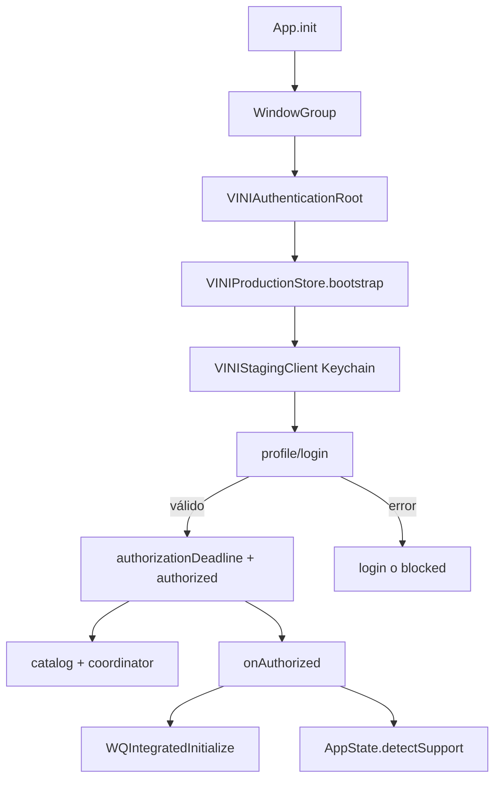
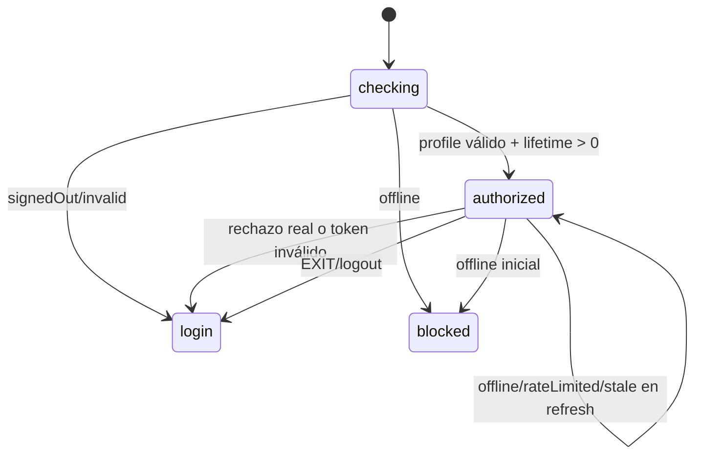
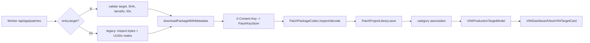
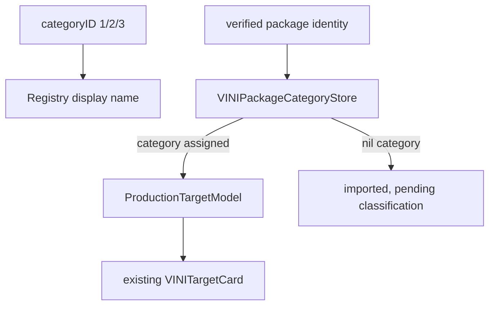
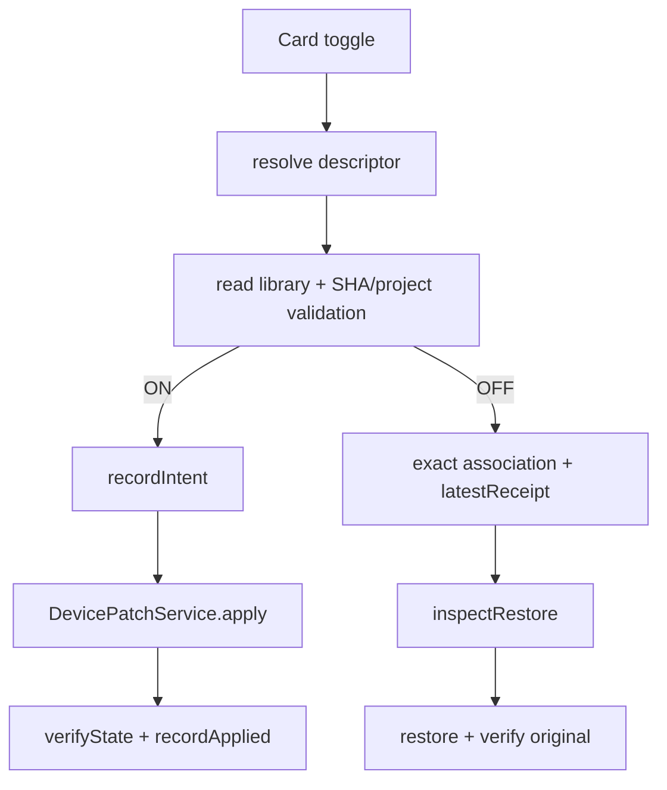
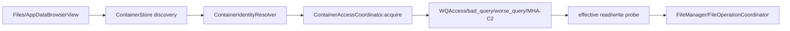
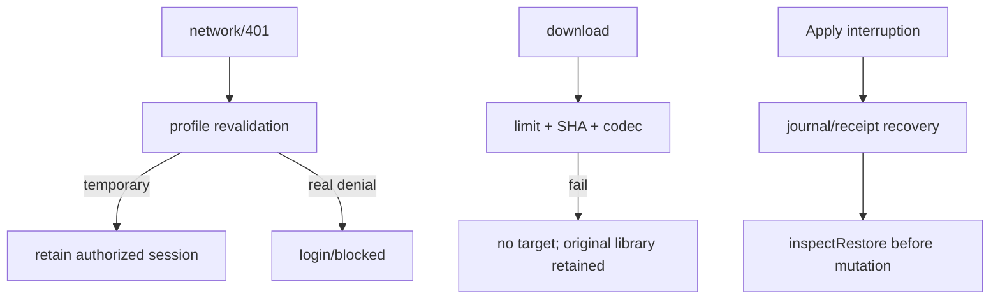
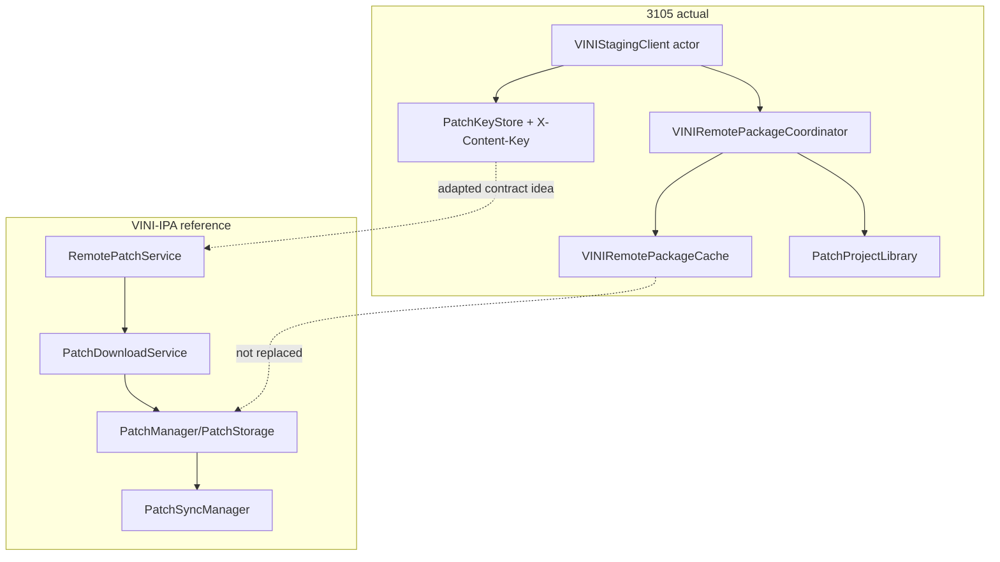

# VINI 3U — flujo técnico comprobado

## Artefactos auditados

- Rama: `experiment/vini-remote-import-ci`
- HEAD auditado antes de este informe: `f2446929f3cf960317ba1c5c915d011183c69e5c`
- Corrección adicional de esta auditoría: `VINIStagingAccountView.swift`, identidad de cuenta estable.
- CI asociado: `43897324178`, HEAD `f2446929`, estado observado `queued`; no produjo IPA.
- Los runs `43896829517` y `43897089045` ejecutaron fixtures y fallaron en compilación; `43891690334` fue cancelado.
- No existe evidencia de un IPA generado para `f2446929`. Por tanto no se atribuyen propiedades de IPA/entitlements a este HEAD.

## Arranque y autenticación

`ThreeOneOSFiveApp.init` configura logging/tema. El `WindowGroup` crea
`VINIAuthenticationRoot`, que crea un `VINIProductionStore` como `@StateObject`.
`bootstrap()` carga Keychain mediante `VINIStagingClient.hasStoredIdentity()` y
llama `refresh(force:true)`. Una licencia válida consulta perfil y catálogo;
solo entonces `onAuthorized` inicializa `WQIntegratedInitialize`, detecta soporte
y actualiza la presentación de engines.

La fase `.checking` con identidad guardada muestra `VINIConnectingView`; la
vista se actualiza cada segundo mediante `TimelineView`. El foreground llama
`refresh(force:true)`. No hay evidencia de ejecución física de este flujo en el
HEAD auditado.

## Sesión y estados

`VINIStagingClient` serializa su estado en un actor. `login` conserva HWID,
rota generación y guarda token/expiry en Keychain. `profile` coalesce una
revalidación concurrente; HTTP 401 borra token, revalida una vez y repite la
petición. `logout` cancela la tarea y conserva únicamente HWID.

El texto `Sesión conservada · conexión pendiente` sale exactamente de
`VINIProductionStore.refresh` cuando la sesión ya estaba autorizada y el error
es `offline`, `rateLimited` o `stale`.

## Catálogo, descarga e importación

`VINIProductionStore.refresh` consulta el catálogo y crea
`VINIRemotePackageCoordinator`. El coordinador consulta nuevamente perfil y
catálogo, por lo que hay dos consultas de catálogo por refresh exitoso. Para
entradas enriquecidas valida metadata, tamaño, SHA, `inspect`, clave y
`projectID`. Para entradas legacy sin `target`, descarga, inspecciona el UUID
real, descifra y guarda con `PatchProjectLibrary`; la identidad `legacy.local`
es local, no un ID del Worker.

El límite de transporte es 64 MiB en `VINIStagingHTTP`; respuestas no-package
están limitadas a 2 MiB. La cache remota valida tamaño y SHA antes de usar bytes.
No se copia `PatchSyncManager` completo de VINI-IPA: el flujo actual usa el
coordinador y biblioteca existentes.

## Categorías y targets

`VINIProductionCategoryRegistry` solo contiene IDs/nombres. La asociación
Codable se guarda en Application Support por usuario, patch, UUIDs, SHA,
revisión y categoría opcional. Sin categoría el paquete puede importarse pero
`preparedPresentations` lo omite. El mapeo final a `VINICategory` está en
`VINIStagingAccountView`; no cambia permisos.

## Apply/Restore

`VINITargetCard` invokes the closure from `VINIDashboardPresentation`. The
store reloads the library, recomputes SHA and project UUID, records intent,
calls `DevicePatchService.apply`, verifies receipt state, then records applied
association. Restore requires an exact association and matching latest receipt,
calls `inspectRestore`, `restore`, and verifies original state. The transaction
engine owns journals/backups; no physical third-party operation was executed.

## Files and containers

`DevicePatchService.withResolvedContainers` resolves paths through
`ContainerStore`, acquires `ContainerAccessCoordinator`, verifies effective
read/write access, and holds sessions for the operation. `FileBrowserView` and
`AppDataBrowserView` use the container/file services; this audit did not alter
those protected paths. Physical provider behavior is unverified.

## Failure recovery

## VINI vs VINI-IPA

VINI-IPA separates `RemotePatchService`, `PatchDownloadService`, storage and
sync manager. The current project instead uses the actor `VINIStagingClient`,
`VINIRemotePackageCoordinator`, `VINIRemotePackageCache` and
`PatchProjectLibrary`, with stricter SHA/identity checks and the existing
transaction engine. `X-Content-Key` handling is present in the current client;
VINI-IPA's sync patterns were reference only.

